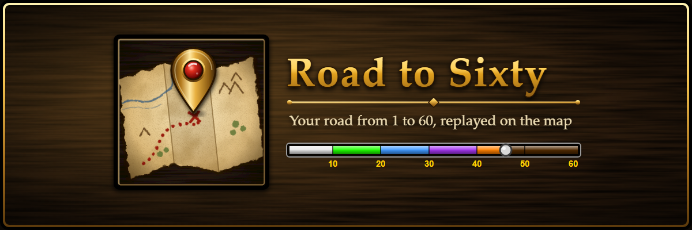
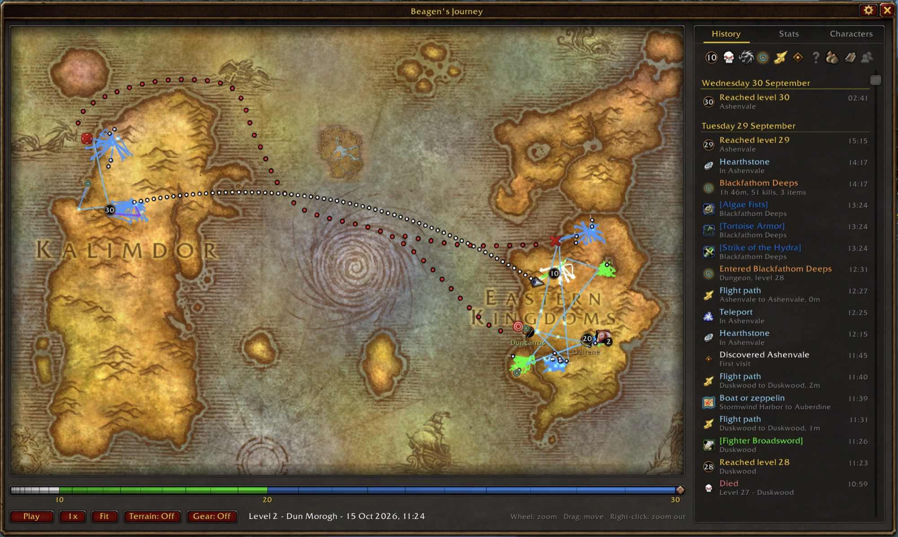

<p align="center"></p>

<p align="center">
  <a href="https://www.curseforge.com/wow/addons/road-to-sixty">Get the addon</a> ·
  <a href="https://roadtosixty.online">Get the app</a> ·
  <a href="CHANGELOG.md">What's new</a>
</p>

# Road to Sixty

A World of Warcraft addon for **WoW Forever** that records each character's
road from level 1 to 60, then replays it on a zoomable world map, in the
spirit of Zelda's Hero's Path. Forever launches on 4 November 2026; install
the addon before then so the road starts at level 1.



## What it records

- **Every step:** where you walked, rode, flew and sailed, coloured by level.
  Boats and zeppelins, hearthstones and teleports each have their own look.
- **Every moment:** quests, kills, deaths, levels, dungeon and raid runs,
  groups and the people in them, guilds, reputation, professions and recipes,
  riding and mounts, rare mobs, and the gear you wore at each level.
- **The replay:** press Play and watch the whole road unfold, with kills,
  quest turn-ins and level-ups popping up along the way.
- **History and Stats:** a day-by-day list you can filter, and your totals.

Open the map with `/rts` (or `/roadtosixty`) or the minimap button.

## The app: one road on every PC

The addon works on its own and keeps everything in your WoW folder. If you
play one character on more than one computer, the free Road to Sixty app
(Mac and Windows, from [roadtosixty.online](https://roadtosixty.online))
backs your journeys up and merges them, so each PC shows the whole road:

- It sends the journey up when you log out, and brings the newest one back
  when the game starts.
- Sessions from different PCs are joined into one journey, not overwritten.
- Earlier versions are kept, so you can go back to one and switch back again.
- You sign in with Battle.net. Download your journeys or delete everything
  from the app at any time. See the [Privacy](https://roadtosixty.online/privacy)
  page for what is kept.

## Licence

All rights reserved. You may install and use Road to Sixty to play World of
Warcraft; see [LICENSE](LICENSE). Road to Sixty is not affiliated with or
endorsed by Blizzard Entertainment.

---

## Development

The repo is a Bun and Turborepo workspace. Each app and package has an
`AGENTS.md` with its own layout, commands and rules.

| Folder | What it is |
|---|---|
| `apps/addon/` | The addon (`RoadToSixty/`), its tests and release scripts |
| `apps/server/` | The sync server: Elysia on Bun, Postgres, R2, Battle.net sign-in (`api.roadtosixty.online`) |
| `apps/desktop/` | The app: a Rust sync engine and a Tauri window |
| `apps/web/` | The website (Astro, on Vercel): [roadtosixty.online](https://roadtosixty.online) |
| `packages/api/` | Request and response types shared by the server, app and website |
| `packages/ui/` | The look the app and website share: theme, fog of war, class icons |
| `branding/` | Icon and header art (`build-header.ps1` rebuilds the header), and the CurseForge screenshots |

```sh
bun install          # once
bun run test         # every test in the repo
bun run typecheck    # TypeScript in the server, website and packages
```

You need [LuaJIT](https://luajit.org/) on the path for the addon, standard
Lua 5.1 and Docker for the server's tests (`docker compose up -d` in
`apps/server/`), and Rust from rustup for the app.
[Lua Language Server](https://luals.github.io/) is optional; when installed,
`apps/addon/check.ps1` also reports its diagnostics.

### The addon

```powershell
cd apps/addon
./check.ps1               # syntax check, diagnostics, offline tests
./scripts/package.ps1     # release build to build/ and dist/, plus a load test in toc order
```

To try the source in game, link or copy `apps/addon/RoadToSixty/` into
`World of Warcraft/_classic_beta_/Interface/AddOns/`. The source includes the
developer tools (`/rts seed`, `/rts swatch`, `/rts icons`, `/rts probe`,
`/rts terrain`, `/rts zoneprobe`, `/rts levelart`, `/rts tiles`, `/rts perf`). Release builds
leave out anything between `#@debug@` / `#@end-debug@` in the toc and
`--@debug@` / `--@end-debug@` in Lua, and drop files the toc no longer lists.

Zone map data (`ZoneOverlays.lua`, `ZoneMasks/`) is generated from the
client's tables on wago.tools. After a patch that changes map art, rerun
`python apps/addon/scripts/zone-overlays.py <build>` (needs Pillow). After any
patch, `apps/addon/scripts/sync-version.ps1` sets the toc's interface number
from the installed client.

### Releases

- **Addon:** add the version's section to `CHANGELOG.md`, then push an
  annotated tag such as `v1.9.0`. The Release workflow checks, builds, makes
  the GitHub release and uploads to CurseForge (tags containing `alpha` or
  `beta` are pre-releases). Watch it to the end: the GitHub release can
  succeed while the CurseForge upload fails, and `curseforge-check.yml`
  re-uploads an existing release.
- **App:** set the version in `apps/desktop/src-tauri/tauri.conf.json` and
  `Cargo.toml`, then push a tag such as `app-v0.1.3`. The workflow builds the
  Mac and Windows apps, signs the updates and uploads them to
  `dl.roadtosixty.online`, where installed apps pick them up.
- **Server and website:** deploy from `dev` on every push (Dokploy and
  Vercel).

CI (`.github/workflows/ci.yml`) runs every check on pushes to `main` and
`dev` and on pull requests.
